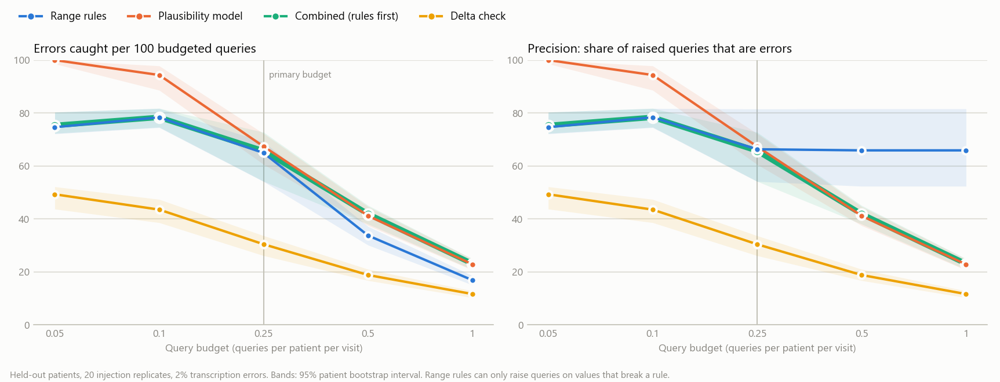
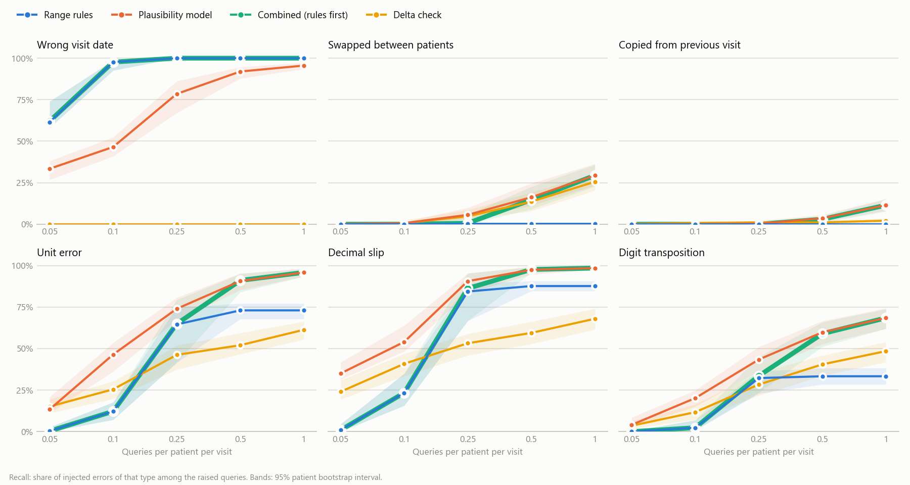
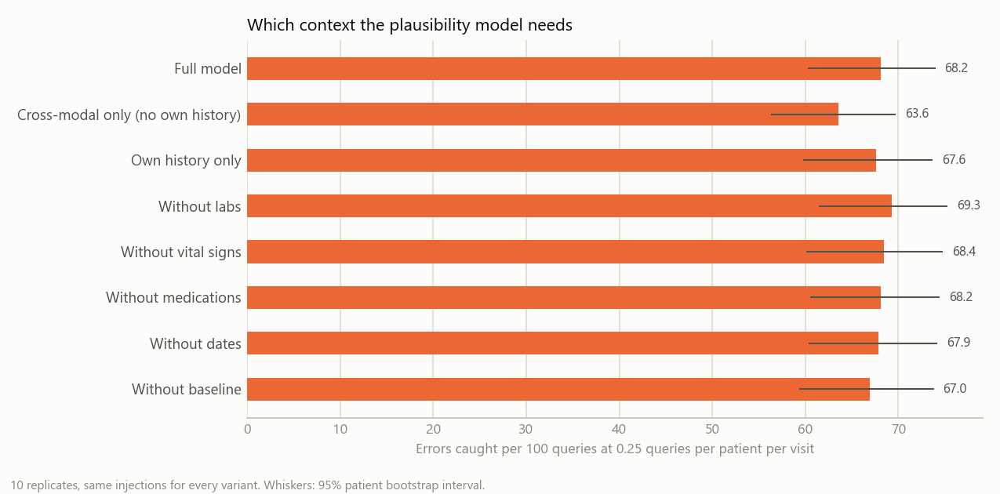
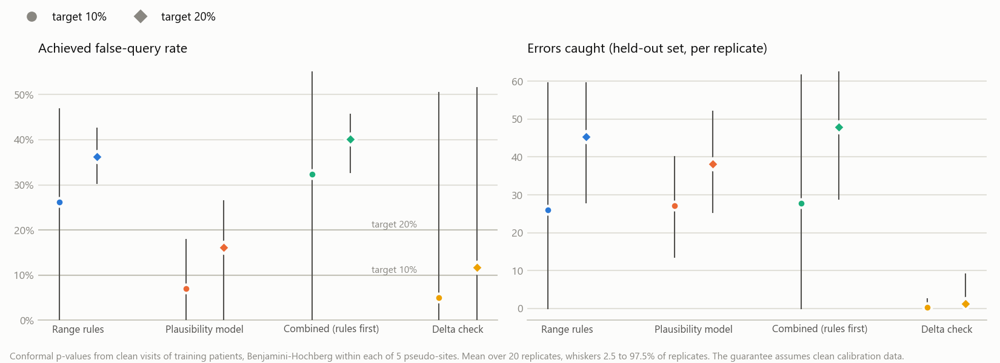
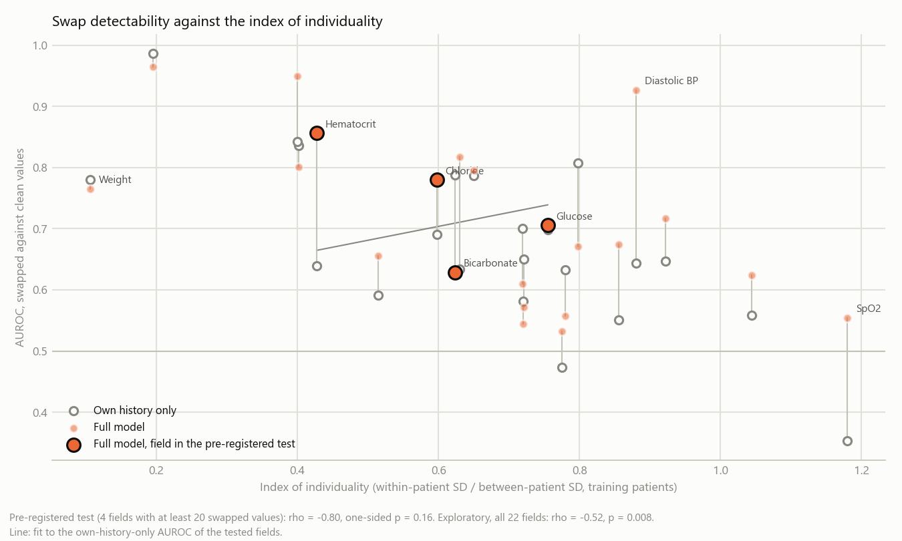

# Budgeted cross-modal plausibility checks for clinical trial data

**When few queries can be sent, a plausibility model that checks each value
against the rest of the patient's record catches clearly more errors per query
than EDC range rules: 1.00 against 0.74 at 0.05 queries per patient per visit,
0.96 against 0.79 at 0.10. With conformal p-values and Benjamini-Hochberg in
place of a fixed budget, false-query control holds for the model (5.7% false
queries at a 10% target, 17.1% at 20%) and fails for the range rules (23.7%
and 35.7%). The pre-specified primary comparison, at 0.25 queries
per patient per visit, found no clear difference: 0.69 against 0.66 errors per
query, +0.03 (95% CI -0.03 to +0.14), on 49 held-out patients with 2% of
values in error.**

**The advantage comes from the patient's own history of the same field. The
model also sees the laboratory values, vital signs and medications of the same
visit, but at daily and weekly visits that context adds almost nothing:
removing any one of them changes nothing, removing the patient's own history
costs 0.05 errors per query. Values copied forward from the previous visit and
values swapped between patients stay largely undetectable from the values
alone: the model catches 0% and 6% of them at the primary budget, the range
rules none.**

A data manager can only send so many queries to a site. This repository asks
whether, at a fixed query budget measured in queries per patient per visit, a
model that judges each recorded value against the patient's other visits and
the other data recorded at the same visit catches more data errors than the
range rules of an EDC system. It uses the MIMIC-IV Clinical Database Demo,
resampled from ICU data to a clinical trial visit schedule, with realistic
transcription errors injected and held-out patients for every reported number.
Errors are detected and explained, never corrected. With more queries than
there are rule violations the model stays ahead (recall 0.68 against 0.51 at
one query per patient-visit), and at 0.5% and 5% error rates it is ahead at
the primary budget too; these comparisons are descriptive.

<picture>
  <source media="(prefers-color-scheme: dark)" srcset="results/figures/budget_comparison_dark.png">
  
</picture>

The comparison is against errors that were injected on purpose. The README
says how many of them each detector finds; it does not say how many real
errors a trial database contains.

## Method in a few sentences

1. **Data.** MIMIC-IV demo v2.2 (100 patients). Day 0 is the first ICU
   admission. Daily visits on days 1 to 7, weekly visits on days 14, 21 and
   28. Each visit has a laboratory form (14 analytes from one blood draw), a
   vital signs form (heart rate, blood pressure, respiratory rate, SpO2,
   temperature, weight; outpatient blood pressure and weight at weekly visits
   after discharge), the daily dose of six concomitant medications, and a date
   for the laboratory and vital signs forms. Diagnoses, age, sex and active
   medication classes are context only. In all: 11,007 cells, 621
   patient-visits, 99 patients with data.
2. **Split.** 50 training and 50 held-out patients, drawn at random; 49 of the
   held-out patients have data. Everything reported is on held-out patients.
3. **Errors.** 2% of cells, six transcription error types in equal shares:
   digit transposition, unit error (for example mg/dL written as mmol/L, kg as
   lb), decimal slip, value copied from the previous visit, wrong visit date
   (day and month exchanged, day digits exchanged, month or year off by one) and
   values swapped between two patients at the same visit. Errors go into
   training and held-out patients alike. 20 injection replicates.
4. **Detectors.** *Range rules*: one plausible range per field and a visit
   window per form date, ranked by how far outside the range a value is.
   *Plausibility model*: per field, a LightGBM model of the value's expected
   level and spread given the patient's other visits, the other modalities at
   the same visit, medication classes and baseline, scored by a robust
   conditional z; fit on training patients only, with patient cross-fitting and
   an explaining-away pass so that one bad value does not make its neighbours
   look wrong. *Delta check*: change since the previous visit (a laboratory
   medicine baseline). *Combined*: rule violations first, then the model. No
   detector restates how the errors were made.
5. **Budget.** At b queries per patient per visit a detector may query the
   b x V highest-ranked cells, V being the held-out patient-visits (306). The
   main metric is errors caught per budgeted query; precision divides by the
   queries actually raised, which differs for the range rules once they run
   out of violations.
6. **Statistics.** 95% intervals from a patient bootstrap of the held-out
   patients (2,000 resamples, the same resamples for every detector, so
   differences are paired), averaged over replicates. One confirmatory
   comparison: model against range rules at 0.25. Everything else is
   descriptive.

Each query comes with one sentence of evidence, for example: *"Hemoglobin
121.0 g/dL at visit D3 is outside the expected range 5.0 to 20.0 g/dL and does
not fit the rest of the record: hemoglobin 11.8 g/dL 2 days earlier, hemoglobin
13.0 g/dL 1 day later. Please check against the source document."* Queries say
what does not fit and never what the value should be.

The plan, written and committed before any detector was run, is in
`docs/analysis_plan.md`, with the implementation details fixed before the run
and four deviations made after it. The literature check, with every citation
verified, is in `docs/literature_check.md`.

## Results

All numbers are from `results/tables/*.csv` and `results/summary.json`.

### Errors caught per query at each budget

| Budget (queries per patient-visit) | 0.05 | 0.10 | **0.25** | 0.50 | 1.00 |
|---|---:|---:|---:|---:|---:|
| Queries | 15 | 31 | 76 | 153 | 306 |
| Plausibility model | **1.00** | **0.96** | 0.69 | 0.42 | 0.23 |
| Range rules | 0.74 | 0.79 | 0.66 | 0.35 | 0.18 |
| Combined (rules first) | 0.75 | 0.79 | 0.67 | 0.42 | 0.24 |
| Delta check | 0.50 | 0.44 | 0.31 | 0.19 | 0.12 |
| Model minus rules | +0.26 (0.19 to 0.28) | +0.17 (0.11 to 0.22) | +0.03 (-0.03 to 0.14) | +0.07 (0.04 to 0.09) | +0.06 (0.05 to 0.07) |

The range rules raise at most 80 queries on the held-out set, because only that
many values break a rule. Their precision therefore stays at 0.67 at the two
largest budgets, while their errors caught per budgeted query falls. The
primary budget sits just below that point, which is also why its interval is
the widest: in some bootstrap resamples the rules can fill the budget and in
others they cannot. Recall at each budget, model against rules: 0.14 against
0.11, 0.28 against 0.23, 0.50 against 0.48, 0.61 against 0.51 and 0.68 against
0.51.

### Which errors are caught

<picture>
  <source media="(prefers-color-scheme: dark)" srcset="results/figures/recall_by_type_dark.png">
  
</picture>

Recall at the primary budget:

| Error type | Plausibility model | Range rules | Combined | Delta check |
|---|---:|---:|---:|---:|
| Decimal slip | 0.89 | 0.83 | 0.85 | 0.53 |
| Unit error | 0.75 | 0.64 | 0.65 | 0.47 |
| Digit transposition | 0.50 | 0.39 | 0.39 | 0.29 |
| Wrong visit date | 0.80 | **1.00** | **1.00** | 0.00 |
| Swapped between patients | 0.06 | 0.00 | 0.00 | 0.05 |
| Copied from previous visit | 0.00 | 0.00 | 0.00 | 0.01 |

By error size (on the field's modelling scale, in robust SDs of the field in
training patients): errors under 0.5 SD are essentially never caught (model
0.005, rules 0.000), errors of 0.5 to 2 SD rarely (0.02 against 0.005), errors
over 2 SD often (0.76 against 0.65). Every injected date error moved the date by
more than 7 days. At one query per patient-visit the model reaches 0.29 of the
swaps and 0.10 of the copies, the range rules 0.00 of both.

### Which context the model needs

<picture>
  <source media="(prefers-color-scheme: dark)" srcset="results/figures/ablation_dark.png">
  
</picture>

Errors caught per query at the primary budget, 10 replicates with the same
injections for every variant:

| Model | Errors per query | Difference to the full model |
|---|---:|---:|
| Full model | 0.682 | |
| Without the patient's own history (cross-modal only) | 0.636 | -0.046 (-0.076 to -0.009) |
| Own history only | 0.676 | -0.005 (-0.034 to 0.025) |
| Without labs | 0.693 | +0.012 (-0.015 to 0.038) |
| Without vital signs | 0.684 | +0.003 (-0.017 to 0.023) |
| Without medications | 0.682 | 0.000 (-0.013 to 0.020) |
| Without dates | 0.679 | -0.003 (-0.005 to 0.007) |
| Without baseline | 0.670 | -0.012 (-0.024 to 0.015) |

Only the patient's own history matters at this budget. Cross-modal context
helps where values are tied to each other at the same visit (see the index of
individuality below), but those fields carry too few of the errors to move the
overall number. On dense ICU data it helped a lot more; see the
[comparison with the first experiment](#comparison-with-the-first-experiment).

### False-query control with conformal p-values

<picture>
  <source media="(prefers-color-scheme: dark)" srcset="results/figures/conformal_dark.png">
  
</picture>

Instead of a fixed budget, each detector's scores were turned into conformal
p-values (Bates et al. 2023), calibrated on clean visits of training patients,
and Benjamini-Hochberg was applied within each of five pseudo-sites. Mean over
20 replicates, with the 2.5 to 97.5% range over replicates:

| Detector | Target | Queries | Per patient-visit | Errors caught | Achieved false-query rate |
|---|---:|---:|---:|---:|---:|
| Plausibility model | 10% | 26.7 | 0.09 | 24.9 | **5.7%** (0 to 14%) |
| Plausibility model | 20% | 47.9 | 0.16 | 38.8 | **17.1%** (2 to 41%) |
| Range rules | 10% | 39.2 | 0.13 | 25.2 | 23.7% (0 to 45%) |
| Range rules | 20% | 71.3 | 0.23 | 46.2 | 35.7% (30 to 42%) |
| Combined | 10% | 42.3 | 0.14 | 26.3 | 27.3% (0 to 51%) |
| Combined | 20% | 81.9 | 0.27 | 50.0 | 39.4% (32 to 49%) |
| Delta check | 10% | 0.5 | 0.00 | 0.3 | 5.0% |
| Delta check | 20% | 2.0 | 0.01 | 1.0 | 12.8% |

The model's false-query rate stays under both targets. The range rules and the
combined detector exceed theirs. The guarantee assumes that calibration values
are exchangeable with the clean held-out values, which here means clean: these
calibration visits are only free of *injected* errors, and real calibration data
never are fully clean. For the rules the failure is visible: the clean
calibration visits contain on average 5 rule violations in 3,644 values (0.15%,
from about 5 patients), while the held-out set has 27 genuine violations in
about 5,300 clean values (0.5%, about 12 patients). With genuine extreme values
three times rarer in calibration than in the data being checked, their
p-values come out too small. A likely reason is that visits with many values
are more likely to contain an injected error and so drop out of the clean
calibration set. These intervals cover injection variability only, not patient
sampling (deviation 1 in the plan).

### The index of individuality and swap detectability

<picture>
  <source media="(prefers-color-scheme: dark)" srcset="results/figures/individuality_dark.png">
  
</picture>

The pre-registered hypothesis was that fields with a lower index of individuality
(Harris 1974: within-patient over between-patient variation, estimated on
training patients) would have their swapped values detected more often.

* **Pre-registered test: not supported.** Only 4 fields reached the minimum of
  20 swapped values (chloride, bicarbonate, glucose, hematocrit). Spearman rho
  -0.80, one-sided permutation p = 0.16. With four points the test could hardly
  have succeeded.
* **Exploratory, all 22 laboratory and vital-sign fields:** rho -0.55, p =
  0.005. The expected relationship is there once all fields are counted, as the
  delta-check literature predicts (Tan et al. 2020).
* **Where cross-modal context changes detectability beyond the index:** among
  the tested fields, hematocrit (AUROC 0.83 against 0.65 with own history only)
  and chloride (0.78 against 0.68). In the exploratory set, diastolic blood
  pressure (0.90 against 0.64) and sodium (0.84 against 0.59) gain most. Of the
  fields expected in advance, the electrolytes and the hematocrit to hemoglobin
  pair behave as expected except bicarbonate (which loses 0.11); the blood
  pressure components gain, but only diastolic pressure by much.

### Sensitivity to the error rate

| Error rate | Model | Range rules | Difference at the primary budget |
|---|---:|---:|---:|
| 0.5% | 0.225 | 0.196 | +0.029 (0.011 to 0.043), model better |
| **2% (primary)** | 0.690 | 0.661 | +0.029 (-0.031 to 0.138), no clear difference |
| 5% | 0.976 | 0.816 | +0.161 (0.110 to 0.199), model better |

## Negative and mixed findings, stated plainly

* **The pre-specified comparison did not show a difference.** At 0.25 queries
  per patient per visit the model and the range rules catch about the same
  number of errors. The model's advantage at smaller and larger budgets, and at
  the other two error rates, is descriptive.
* **Copied values are not caught.** A value copied from the previous visit is,
  to a plausibility model, a patient being stable. Neither detector finds more
  than 1% of them at the primary budget. A check that would find them (value
  identical to the previous visit) restates the error and was excluded by
  design.
* **Swaps between patients are barely caught** (6% at the primary budget). Per
  field the model separates swapped from clean values with an AUROC between
  0.48 and 0.96, below the 0.97 that a multianalyte delta check reached on
  consecutive inpatient chemistry results (Rosenbaum and Baron 2018). Here
  visits are a day or a week apart, and a swapped value is usually within the
  receiving patient's normal range.
* **Cross-modal context adds little overall.** The model works mostly through
  the patient's own history. Its cross-modal gains are confined to fields that
  are arithmetically tied (hematocrit and hemoglobin, the electrolytes,
  diastolic pressure).
* **Range rules are better for dates.** The visit window check catches every
  wrong date; the model 80% at the primary budget. In these data that is partly
  by construction: genuine visit dates always lie inside their window, so the
  rule has no false alarms on dates. The combined detector keeps both
  strengths.
* **The delta check is worse than the range rules at every budget.**
* **False-query control works only where the calibration assumption is close
  to true.** It held for the model and failed for the rules and the combined
  detector.
* **The index of individuality test was underpowered** and is not supported as
  pre-registered.
* **Some false queries are probably real errors.** For example, a calcium of
  2.7 mg/dL between readings of 8.3 and 8.5 counts as a false query because it
  was not injected.

## Comparison with the first experiment

An earlier proof of concept on the same demo (not part of this repository)
scored every value at its own timestamp, which for ICU vital signs means about
hourly. There the model caught 42% of swapped values, and the other modalities
mattered: 27% with the patient's own trajectory only, 20% with the other
modalities only, 42% with both. Here swap recall is 6% at the primary budget
and the other modalities add almost nothing. Several things changed at once,
so this is not a controlled comparison:

* **Operating point.** The 42% is recall at |z| > 4, which queried 4.3% of
  all values (5,437 of 127,414). The primary budget here queries 1.4% of the
  held-out cells (76 of 5,422), and swaps compete with five other error types
  for those queries. At one query per patient-visit (5.6% of cells) swap
  recall is 29%.
* **How swaps were made.** There a swapped value had to differ from the
  original by at least one robust SD; here any two patients' values for the
  same field and visit are exchanged, so some swaps change almost nothing.
* **Measurement density.** Hourly, the neighbouring values of the same field
  are an hour to half a day away and the patient has hardly changed. At daily
  and weekly visits they are one to seven days away and the illness itself
  moves the values. Here 46% of swaps move the value by less than two of the
  patient's typical visit-to-visit SDs (median within-patient SD of the field
  in training patients).
* **How much same-time context there is to learn from.** The dense data had
  127,414 values, 88,038 of them vital signs, every blood pressure charted with
  its components, and an anion gap field tied to sodium, chloride and
  bicarbonate. Here there are 11,007 cells, about half of them in training
  patients, and no anion gap. A tree model has few examples from which to learn
  that MAP is about (SBP + 2 DBP) / 3. Mean arterial pressure went from 12% to
  79% swap recall with cross-modal context on dense data; here its AUROC moves
  from 0.65 to 0.72.
* **Other differences:** 5% errors instead of 2%, and no held-out patients in
  the first experiment.

The fields that gain from cross-modal context are the same in both: diastolic
pressure (dense swap recall 13% to 57%; here AUROC 0.64 to 0.90), sodium (29%
to 53%; 0.59 to 0.84) and hematocrit (41% to 60%; 0.65 to 0.83). Here those
gains are too small at the top of the ranking to matter: at one query per
patient-visit, in the 10 ablation replicates, adding the other modalities to
the own-history model raises swap recall from 0.22 to 0.25 (difference 0.04,
95% CI -0.03 to 0.10), against 27% to 42% on dense data.

**A hypothesis for future work, not a finding of this repository:**
measurement density is one of the factors that decide when multimodal context
helps. When fields are recorded often and together, the same-time values of
other fields say a lot about the value being checked and there are enough of
them to learn how fields move together; at trial-like visit frequencies the
patient's own history carries most of the signal. Testing this needs a sweep
over visit spacing on the same data (for example hourly, every 6 hours, daily,
weekly) with the swap definition, error rate, held-out patients and budget
held fixed. Nothing here tests it.

## What is new

`docs/literature_check.md` records the search. As far as it goes:

1. **Value-level detectors compared at fixed query budgets** in queries per
   patient per visit, with errors caught per query and precision at each
   budget. Central statistical monitoring works at the level of the centre
   (Venet et al. 2012, Trotta et al. 2019, de Viron et al. 2024) or the form
   (Nelson et al. 2025); data-cleaning work reports precision and recall at a
   tool's own threshold or fixes the labeling effort (Raha, Baran), and Abedjan
   et al. 2016 order tools to save verification effort on enterprise data.
2. **The setting:** EDC-style range rules against a plausibility model that is
   given the patient's history and the other modalities, on ICU data
   resampled to a trial schedule, with a modality ablation that measures how
   much of that context the model uses, transcription errors only, held-out
   patients and a pre-registered plan.
3. **Conformal false-query control for clinical data queries.** The method is
   Bates et al. 2023; only its use here is new.

Not new: error injection for evaluation, cell-level precision and recall,
scoring a value against its context (HoloClean, multianalyte delta checks), and
the link between biological variation and swap detectability (Tan et al. 2020).
If you know of prior work comparing detectors at a fixed query budget in
clinical data management, please open an issue so the claim can be corrected.

## How to reproduce

```bash
git clone https://github.com/Jkovv/budgeted-crossmodal-plausibility
cd budgeted-crossmodal-plausibility
pip install -r requirements.txt     # Python 3.11+, pinned versions
make all                            # download, prepare, all runs, evaluate, figures, examples, notebook
make test                           # unit tests (no data needed)
```

`make all` downloads the ten demo tables (about 8 MB, checked against
PhysioNet's SHA-256 sums) and runs `python -m bcp.cli` with the steps
`prepare`, `primary`, `ablation`, `sensitivity`, `evaluate`, `figures` and
`explain`, then executes `notebooks/walkthrough.ipynb`. On a 12-core laptop
with three worker processes (`WORKERS=3`) the runs take about 27 minutes
(primary 6, ablation 16, sensitivity 6) and the evaluation about 4. Results are
deterministic for the seeds in `src/bcp/config.py`. Set `BCP_DATA_DIR` to keep
the data outside the repository.

```
data/        download script and data documentation (no data is committed)
docs/        literature_check.md, analysis_plan.md
src/bcp/     load, resample (visit schedule), inject (errors), rules, delta,
             features, plausibility (model and explaining away), stats,
             evaluation, explain (query text), plots, run, cli
notebooks/   walkthrough.ipynb, executed
results/     figures/, tables/ and summary.json (aggregates only; row-level
             outputs go to results/cells/ and are not committed)
tests/       resampling, error injection, detectors, statistics (budget counts,
             bootstrap, conformal p-values, Benjamini-Hochberg) and evaluation
```

## Limitations

* **Injected errors, not real ones.** The six types are realistic transcription
  errors, but their equal shares and the 2% rate are choices. The ranking of
  the detectors depends on the mix, as the sensitivity analysis shows for the
  rate.
* **A small demo.** 49 held-out patients and 306 held-out patient-visits; the
  intervals are wide. One hospital, so the conformal sites are pseudo-sites.
* **ICU data are not trial data.** Visits are resampled from routine care, the
  weekly visits are sparse and come from outpatient records, and doses come
  from orders, not administrations. Genuine visit dates fall inside their
  window by construction.
* **Fixed settings.** The range limits come from an earlier proof of concept
  (one limit was changed knowing those results, as the plan states). The model's
  settings were fixed in advance and never tuned, so no claim is made that they
  are the best ones.
* **MIMIC values are taken as correct** apart from four impossible values
  removed before injection. Real recording errors in MIMIC count against every
  detector as false queries.
* **The conformal guarantee** needs clean calibration data, which no real
  calibration set is, and its intervals here reflect injection variability
  only.
* **The individuality analysis** uses variation during illness, not healthy
  biological variation, does not separate analytical variation, and had four
  eligible fields.
* **The query text has not been tested with data managers.**

## Data citation and license

Johnson, A., Bulgarelli, L., Pollard, T., Horng, S., Celi, L. A., & Mark, R.
(2023). *MIMIC-IV Clinical Database Demo* (version 2.2). PhysioNet.
https://doi.org/10.13026/dp1f-ex47. Open Data Commons Open Database License
v1.0. The data are not redistributed here; `data/download_mimic_demo.py`
fetches them from PhysioNet.

Johnson, A. E. W., Bulgarelli, L., Shen, L., et al. (2023). MIMIC-IV, a freely
accessible electronic health record dataset. *Scientific Data*, 10, 1.
https://doi.org/10.1038/s41597-022-01899-x

Pollard, T., Moody, B. E., Lehman, L. H., Gow, B. J., Fernandes, C., Xie, C.,
et al. (2026). PhysioNet as a global platform for biomedical research. *Nature
Health*, 1(8), 792-795. https://doi.org/10.1038/s44360-026-00096-z

## Key references

The full list, with what each paper is used for, is in
`docs/literature_check.md`.

* Rekatsinas T, Chu X, Ilyas IF, Re C. HoloClean: holistic data repairs with probabilistic inference. *Proc VLDB Endow* 2017;10(11):1190-1201. https://doi.org/10.14778/3137628.3137631
* Mahdavi M, Abedjan Z, Castro Fernandez R, et al. Raha: a configuration-free error detection system. *SIGMOD* 2019:865-882. https://doi.org/10.1145/3299869.3324956
* Mahdavi M, Abedjan Z. Baran: effective error correction via a unified context representation and transfer learning. *Proc VLDB Endow* 2020;13(12):1948-1961. https://doi.org/10.14778/3407790.3407801
* Abedjan Z, Chu X, Deng D, et al. Detecting data errors: where are we and what needs to be done? *Proc VLDB Endow* 2016;9(12):993-1004. https://doi.org/10.14778/2994509.2994518
* Venet D, Doffagne E, Burzykowski T, et al. A statistical approach to central monitoring of data quality in clinical trials. *Clin Trials* 2012;9(6):705-713. https://doi.org/10.1177/1740774512447898
* Trotta L, Kabeya Y, Buyse M, et al. Detection of atypical data in multicenter clinical trials using unsupervised statistical monitoring. *Clin Trials* 2019;16(5):512-522. https://doi.org/10.1177/1740774519862564
* de Viron S, Trotta L, Steijn W, Young S, Buyse M. Does central statistical monitoring improve data quality? *Ther Innov Regul Sci* 2024;58(3):483-494. https://doi.org/10.1007/s43441-024-00613-w
* Nelson W, Petch J, Ranisau J, et al. Detecting irregularities in randomized controlled trials using machine learning. *Clin Trials* 2025;22(2):178-187. https://doi.org/10.1177/17407745241297947
* ICH E6(R3) Guideline for Good Clinical Practice, Step 4, 6 January 2025. FDA, *Oversight of Clinical Investigations: A Risk-Based Approach to Monitoring*, August 2013, and *A Risk-Based Approach to Monitoring of Clinical Investigations: Questions and Answers*, April 2023.
* Fougerou-Leurent C, Laviolle B, Tual C, et al. Impact of a targeted monitoring on data-quality and data-management workload of randomized controlled trials. *Br J Clin Pharmacol* 2019;85(12):2784-2792. https://doi.org/10.1111/bcp.14108
* Garza MY, Williams T, Ounpraseuth S, et al. Error rates of data processing methods in clinical research. *Int J Med Inform* 2025;195:105749. https://doi.org/10.1016/j.ijmedinf.2024.105749
* Bates S, Candes E, Lei L, Romano Y, Sesia M. Testing for outliers with conformal p-values. *Ann Stat* 2023;51(1):149-178. https://doi.org/10.1214/22-AOS2244
* Benjamini Y, Hochberg Y. Controlling the false discovery rate. *J R Stat Soc Series B* 1995;57(1):289-300. https://doi.org/10.1111/j.2517-6161.1995.tb02031.x
* Harris EK. Effects of intra- and interindividual variation on the appropriate use of normal ranges. *Clin Chem* 1974;20(12):1535-1542. https://doi.org/10.1093/clinchem/20.12.1535
* Tan RZ, Markus C, Loh TP. Relationship between biological variation and delta check rules performance. *Clin Biochem* 2020;80:42-47. https://doi.org/10.1016/j.clinbiochem.2020.03.017

## License

Code: MIT (see `LICENSE`). The MIMIC-IV demo data are under the ODbL and are
not part of this repository.
